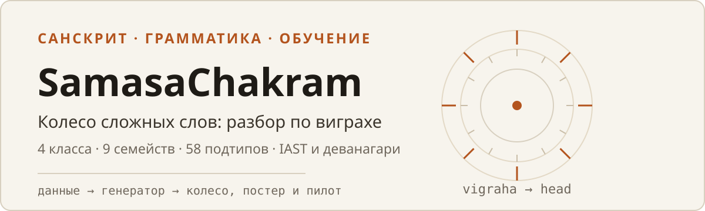
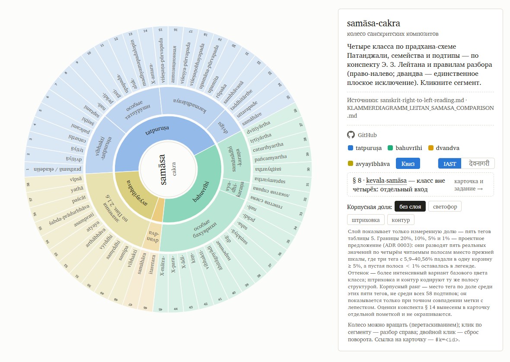

# SamasaChakram — колесо санскритских композитов

_Created: 11-07-2026 · Last updated: 24-11-2026_

[](https://github.com/gasyoun/SamasaChakram/blob/main/LICENSE)
[](https://gasyoun.github.io/SamasaChakram/)
[](https://scorecard.dev/viewer/?uri=github.com/gasyoun/SamasaChakram)



> **Живой проект.** Программа samāsa собрана здесь 16-07-2026 (H1010): система рисования
> Klammerdiagramm, галерея разобранных примеров, общий метод чтения справа налево и
> сличение с конспектом Э. З. Лейтан.

**Первый шаг:** [откройте колесо](https://gasyoun.github.io/SamasaChakram/) — поверните его,
нажмите на лепесток и сразу увидите виграху и русский глосс. Кнопка «Квиз» в легенде
проверяет те же 58 подтипов; переключатель IAST ⇄ деванагари и светлая/тёмная тема
работают без перезагрузки.



## Что это

*Samāsa cakra* («колесо композитов») — традиционное учебное средство: схема в форме
колеса, на которой изучают классификацию и разбор (*vigraha*) санскритских сложных слов —
*tatpuruṣa* (включая *karmadhāraya* и *dvigu*), *bahuvrīhi*, *dvandva*, *avyayībhāva*.

Этот репозиторий — цифровое воплощение: колесо, полностью воспроизводимое из
одного файла таксономии, плюс система bracket-диаграмм Klammerdiagramm, метод чтения
справа налево и научное сличение, на котором всё построено. Таксономия содержит
**4 класса, 9 семейств и 58 подтипов**; канонический пример каждого подтипа взят из
конспекта Лейтан. У **17 лепестков** есть собственная bracket-диаграмма (18 адресов SVG —
у одного лепестка две), остальные связаны с галереей.

## Что можно делать прямо сейчас

- **[Колесо](https://gasyoun.github.io/SamasaChakram/)** — вращение, клик по лепестку,
  стабильные номера по часовой стрелке, переключение шрифтов и тем, ссылки вида `#k=<id>`
  прямо на лепесток. Квиз работает на той же таксономии, без второго банка вопросов.
  Подписи идут тремя рядами — классы, семейства, лепестки (20/19/18 px); при загрузке
  лепесток № 1 стоит на левом экваторе, курсив подлинный (не синтетический наклон).
- **[Пять уроков](https://gasyoun.github.io/SamasaChakram/uroki/)** — rāja-bhāryā,
  вложенный dvandva, rāmeśvaraḥ, prathamā / ekadeśin, kevala-samāsa. Каждый сразу
  показывает виграху и учебную схему, формальные диаграммы свёрнуты и подписаны
  моделью и источником, а в конце — упражнение в Drumam с обратной связью.
- **[Указатель параграфов](https://gasyoun.github.io/SamasaChakram/paragrafy/)** —
  67 §§ конспекта Лейтан с постоянными якорями (`#p-4-1-1`) и ссылками на разбор
  (или честной пометкой «разбора в пилоте нет»).
- **[Дерево решений Drumam](https://gasyoun.github.io/SamasaChakram/drumam/) и
  [тренажёр](https://gasyoun.github.io/SamasaChakram/drumam/samasa_trainer.html)** —
  классификация по шагам и тренировка.
- **[Постер A2](https://github.com/gasyoun/SamasaChakram/blob/main/samasacakra/samasacakra-poster.pdf)** —
  420 × 594 мм: двуязычный заголовок, колесо на всю ширину и полный указатель 58 подтипов
  в четырёх колонках классов.

## Хаб знаний

[Указатель активов по samaсам во всём поместье](docs/SAMASA_KNOWLEDGE_HUB.md) — где лежит
золото с меткой типа (Gita-gold, Sangram P4), частотные композиты DCS/Kompozity,
кёльнские словарные данные, практика в kosha/csl-guides и какие есть ограничения.
Это указатель, а не копия данных: этот репозиторий остаётся педагогическим ядром.

## Корпусный слой: измеренное и оценённое

Слой корпусных долей имеет **одну легенду и три взаимозаменяемые кодировки** — светофор,
штриховку и контур — с пятью состояниями: ≥ 20 %, 10–< 20 %, 5–< 10 %, 1–< 5 % и «нет
сопоставимой доли». Полоса < 1 % убрана: ни один измеренный тег туда не попадает.

- **Измеренные доли** — пять значений из таблицы 5 работы Kulkarni & Kumar (2013),
  выборка ≈ 64 000 двучленных композитов: ṣaṣṭhī 40,56 %, viśeṣaṇapūrvapada 12,29 %,
  ṣaṣṭhyartha-bv 6,39 %, nañ- 5,9 %, upapada 4,32 %. Границы полос и отказ от чужой
  зелёно-красной палитры зафиксированы в
  [ADR 0003](https://github.com/gasyoun/SamasaChakram/blob/main/docs/adr/0003-corpus-share-band-scale.md):
  слой использует более интенсивный оттенок базового цвета класса. Каждая карточка
  указывает ранг и поясняет, что ранжируются именно пять измеренных меток, а не все 58
  подтипов.
- **Оценки § 14 конспекта** (`~1,6 %`, `~9 %`, `~3 %`, `< 1 %`, `~2,0 %` для группы)
  остаются примечаниями карточек: без цвета, без ранга, никогда не в виде доли.
- Доля приписывается подтипу **только при точном совпадении корпусной метки**
  ([ADR 0002](https://github.com/gasyoun/SamasaChakram/blob/main/docs/adr/0002-corpus-frequency-and-wheel-labels.md));
  `kevala-samāsa` не имеет лепестка и показывается отдельной карточкой рядом с колесом.

## Как это собрано

Один источник → генератор → артефакты:

- [samasacakra/samasacakra-taxonomy.json](https://github.com/gasyoun/SamasaChakram/blob/main/samasacakra/samasacakra-taxonomy.json)
  + [samasacakra/build_samasacakra.py](https://github.com/gasyoun/SamasaChakram/blob/main/samasacakra/build_samasacakra.py)
  → интерактивная HTML-страница колеса, SVG, PNG и постер; встроенный квиз строится из
  того же `META`, что и карточки.
- [samasacakra/pilot_data.json](https://github.com/gasyoun/SamasaChakram/blob/main/samasacakra/pilot_data.json)
  + [samasacakra/build_pilot.py](https://github.com/gasyoun/SamasaChakram/blob/main/samasacakra/build_pilot.py)
  → пять уроков и указатель параграфов; исходник — DOCX конспекта.
- Приёмка fail-closed: [samasacakra/check_pilot.py](https://github.com/gasyoun/SamasaChakram/blob/main/samasacakra/check_pilot.py)
  (260 проверок), [samasacakra/check_quiz.py](https://github.com/gasyoun/SamasaChakram/blob/main/samasacakra/check_quiz.py)
  (7 маркеров в двух страницах, 58+ ответов) и
  [scripts/check_example_pack.py](https://github.com/gasyoun/SamasaChakram/blob/main/scripts/check_example_pack.py)
  (0 жёстких ошибок).

### Быстрый старт для разработчика

Нужны Python 3, `python-docx` и `indic-transliteration`: генераторы читают DOCX и
транслитерируют IAST. Отдельного файла зависимостей в репозитории нет. Из корня клона:

```bash
python samasacakra/build_samasacakra.py   # колесо, страница и постер
python samasacakra/build_pilot.py         # уроки и указатель (67 §§)
python samasacakra/check_pilot.py         # 260/260 — exit 0
python samasacakra/check_quiz.py          # QUIZ CHECK: PASS
python scripts/check_example_pack.py      # PASS — 0 hard failures
```

## Карта репозитория

| Путь | Что там |
|---|---|
| [samasacakra/](https://github.com/gasyoun/SamasaChakram/tree/main/samasacakra) | таксономия, генератор, колесо (SVG/HTML/PNG), постер, страницы Pages, подмножество Klammer Deva |
| [klammerdiagramm/](https://github.com/gasyoun/SamasaChakram/tree/main/klammerdiagramm) | [генератор](https://github.com/gasyoun/SamasaChakram/blob/main/klammerdiagramm/build_klammerdiagramm.py), 20 SVG-пластин, 21 конфигурация, подмножество Charis и его лицензия |
| [klammerdiagramm-worked-examples.md](https://github.com/gasyoun/SamasaChakram/blob/main/klammerdiagramm-worked-examples.md) | галерея: 11 разобранных разделов, от пары лемм до итогового примера со всеми пятью видами |
| [sanskrit-right-to-left-reading.md](https://github.com/gasyoun/SamasaChakram/blob/main/sanskrit-right-to-left-reading.md) | канонический метод чтения справа налево (head last) и все решения MG о направлении; общий источник для навыков `/sanskrit-parse`, `/klammeruebersetzung`, `/klammerdiagramm` |
| [KLAMMERDIAGRAMM_LEITAN_SAMASA_COMPARISON.md](https://github.com/gasyoun/SamasaChakram/blob/main/KLAMMERDIAGRAMM_LEITAN_SAMASA_COMPARISON.md) | сличение системы рисунка с конспектом Лейтан, шесть голосований D1–D6 |
| [leitan/](https://github.com/gasyoun/SamasaChakram/tree/main/leitan) | текстовая вычитка конспекта и [письмо-запрос рецензии](https://github.com/gasyoun/SamasaChakram/blob/main/leitan/LEITAN_REVIEW_REQUEST_DRAFT_16.07.26.md), отправленное 16-07-2026 |
| [docs/](https://github.com/gasyoun/SamasaChakram/tree/main/docs) | источник Pages: [index.html](https://github.com/gasyoun/SamasaChakram/blob/main/docs/index.html), [llms.txt](https://github.com/gasyoun/SamasaChakram/blob/main/docs/llms.txt), уроки, указатель, два DOCX конспекта и приложения |
| [docs/adr/](https://github.com/gasyoun/SamasaChakram/tree/main/docs/adr) | [0001](https://github.com/gasyoun/SamasaChakram/blob/main/docs/adr/0001-leitan-source-and-editorial-differences.md) — конспект как главный источник; [0002](https://github.com/gasyoun/SamasaChakram/blob/main/docs/adr/0002-corpus-frequency-and-wheel-labels.md) — корпусная доля только по точной метке; [0003](https://github.com/gasyoun/SamasaChakram/blob/main/docs/adr/0003-corpus-share-band-scale.md) — новые полосы 20/10/5/1 % и цвет класса |
| [drumam/](https://github.com/gasyoun/SamasaChakram/tree/main/drumam) и [docs/drumam/](https://github.com/gasyoun/SamasaChakram/tree/main/docs/drumam) | исходник дерева решений, данные, архив версий; [диаграммы](https://github.com/gasyoun/SamasaChakram/tree/main/docs/drumam/diagrams) |
| [teaching-pack/](https://github.com/gasyoun/SamasaChakram/tree/main/teaching-pack) | [EXAMPLE_PACK.md](https://github.com/gasyoun/SamasaChakram/blob/main/teaching-pack/EXAMPLE_PACK.md), манифест, проверочные canary и печатные/браузерные доказательства |
| [reports/](https://github.com/gasyoun/SamasaChakram/tree/main/reports) | [H8573_PILOT_DELIVERY.md](https://github.com/gasyoun/SamasaChakram/blob/main/reports/H8573_PILOT_DELIVERY.md) и [DRUMAM_IMPORT_DECISIONS_24-11-2026.md](https://github.com/gasyoun/SamasaChakram/blob/main/reports/DRUMAM_IMPORT_DECISIONS_24-11-2026.md) |
| [CONTEXT.md](https://github.com/gasyoun/SamasaChakram/blob/main/CONTEXT.md) | глоссарий предметной области (samāsa, vigraha, pradhāna, класс/семейство/лепесток, измеренная доля/оценка) |
| [CHANGELOG.md](https://github.com/gasyoun/SamasaChakram/blob/main/CHANGELOG.md), [changelog_queue/](https://github.com/gasyoun/SamasaChakram/tree/main/changelog_queue), [SECURITY.md](https://github.com/gasyoun/SamasaChakram/blob/main/SECURITY.md), [.ai_state.md](https://github.com/gasyoun/SamasaChakram/blob/main/.ai_state.md), [AGENTS.md](https://github.com/gasyoun/SamasaChakram/blob/main/AGENTS.md) | release-notes, очередь записей, политика безопасности, журнал сессий и инструкции для агентов |

## Происхождение и правила

- **Таксономия**: Э. З. Лейтан, «Сложные слова в санскрите» (конспект программы вебинара MG);
  сличение — в [KLAMMERDIAGRAMM_LEITAN_SAMASA_COMPARISON.md](https://github.com/gasyoun/SamasaChakram/blob/main/KLAMMERDIAGRAMM_LEITAN_SAMASA_COMPARISON.md).
  При расхождениях главный источник — конспект; интерпретации проекта фиксируются явно
  ([ADR 0001](https://github.com/gasyoun/SamasaChakram/blob/main/docs/adr/0001-leitan-source-and-editorial-differences.md)).
- **Структурные решения (MG)**: каждый samāsa связывается справа налево (глава — последний
  член); экзоцентричность bahuvrīhi и выделенность первого члена avyayībhāva — семантика, а не
  направление скобок; плоский только dvandva; шесть голосований D1–D6 применены повсюду.
- **Шрифты**: Klammer Serif (подмножество Charis 7.000) и Klammer Deva (подмножество Noto
  Serif Devanagari) переименованы по правилам OFL Reserved Font Name; лицензии лежат рядом,
  сценарии сборки зафиксированы.
- Три навыка, которые **потребляют** этот материал (`/sanskrit-parse`, `/klammeruebersetzung`,
  `/klammerdiagramm`), живут в [claude-config](https://github.com/gasyoun/claude-config);
  репозиторий записан в [Uprava/PROJECT_INTERLINKS.md](https://github.com/gasyoun/Uprava/blob/main/PROJECT_INTERLINKS.md)
  как источник, который следует использовать, а не воссоздавать.

## Статус

Жив с 16-07-2026: консолидация H1010 → колесо H1016 → деванагари H1017 → плашки в панели
H1020/H1026 → постер H1021 → плашки D-голосований H1025 → полное покрытие галереи H1030 →
Pages H1036 → пилот H8573 → встроенный квиз #40. Текущие релизы — в
[CHANGELOG.md](https://github.com/gasyoun/SamasaChakram/blob/main/CHANGELOG.md) и на
[странице релизов](https://github.com/gasyoun/SamasaChakram/releases).

**@WAITING**: письмо Э. З. Лейтан отправлено 16-07-2026; его правки пойдут в
[samasacakra/samasacakra-taxonomy.json](https://github.com/gasyoun/SamasaChakram/blob/main/samasacakra/samasacakra-taxonomy.json)
(одна пересборка обновит колесо, сайт и постер), а его слово о копии конспекта — окончательное.
Журнал сессий: [.ai_state.md](https://github.com/gasyoun/SamasaChakram/blob/main/.ai_state.md).

## Лицензия

[Apache License 2.0](https://github.com/gasyoun/SamasaChakram/blob/main/LICENSE).

_Dr. Mārcis Gasūns_
