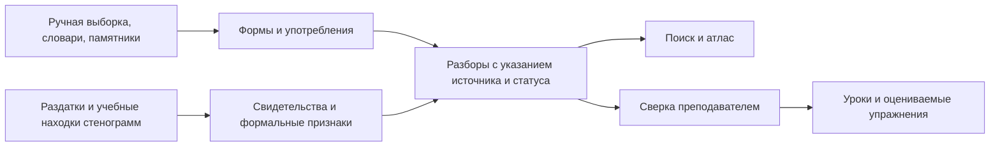

# Учебный атлас самас и корпусные индексы

_Согласовано 26 ноября 2026 г. · H8620_

Ученик начинает с примера в предложении, называет основание для выбора класса, затем строит vigraha. По той же форме он может найти словарную статью, употребления в памятниках и несколько разборов. Первый выпуск использует ручную выборку и проверенные материалы занятий. Первый корпусный прирост добавляет Monier-Williams и «Бхагавадгиту».

## Модель данных

| Запись | Что в ней хранится |
|---|---|
| Источник и редакция | Словарь, памятник, публикация, раздатка или авторский комментарий. Для импорта фиксируются редакция, доступ, допустимый объём публикации, способ получения и версия обработчика. |
| Форма samāsa | Устойчивый поисковый идентификатор и варианты IAST, деванагари и написания источника. Совпадение нормализованного написания предлагает связь, сохраняя омографы и исходные формы. |
| Употребление | Ссылка на форму и точное место в редакции: словарная статья или её смысл, стих и номер слова, страница и строка. Хранит достаточный синтаксический контекст и отмечает его отсутствие. Повтор слова в другом месте получает свой идентификатор. |
| Структурный разбор | Членение и дерево с упорядоченными дочерними узлами. В узле хранятся границы, лексический класс члена, его морфологическая форма, роль в узле, синтаксическая функция целого, кандидаты на класс и ссылка на лепесток при точном соответствии. Исходная метка сохраняется рядом. |
| Свидетельство | Источник, точное место, наблюдение и объяснение, какой узел или кандидат оно поддерживает, ограничивает или оставляет открытым. Авторский разбор, редакторская реконструкция и машинная гипотеза различимы. |
| Формальный признак | Позиция, область действия, условие применения, сила вывода, подтверждающий пример, контрпример и наблюдение, способное изменить вывод. Применение признака ссылается на конкретную версию правила. |
| Визуальный источник | Страница PDF и элемент DOC, если доступен, либо привязка к HTML. Лестница относится к длинной samāsa. Сохраняем порядок строк, положение табуляции в доступном оригинале, видимые отступы, пунктуацию, подпись и границы. Учебная схема указывает, что восстановил редактор. |
| Формула vigraha и её применение | Для каждого типа фиксируются характерные формулы с источником и условием применения. Конкретная vigraha ссылается на формулу, тип и узел структурного разбора. При нескольких разборах одного употребления у каждого своя vigraha. |
| Учебный эталон | Проверенное преподавателем употребление с допустимыми членениями, группировками, классами и аргументами. Отдельная рубрика vigraha проверяет формулу и её применение к узлу для выбранного разбора. |

Связь «форма → употребления → разборы» допускает пополнение с любой глубины. Импорт вправе добавить только форму и место. Членение, дерево, класс, свидетельство, vigraha и проверка преподавателем пополняются независимо. При повторном импорте той же редакции ключи и результат воспроизводятся. Новая редакция или иной анализ получают собственную версию, чтобы уже проведённая проверка оставалась проверяемой.

Ключ употребления состоит из идентификатора редакции и адреса записи внутри неё. Ключ формы сохраняется при добавлении написания или правке нормализации. Разбор ссылается на употребление, а редакторская проверка утверждает конкретные версии разбора и признаков. При изменении кандидата или правила прежняя проверка остаётся доступной и текущий эталон ждёт повторной сверки. Пустое значение для класса обозначает отсутствие разметки, а несколько значений означают конкурирующие классы. Для форм, найденных только машинным поиском, сохраняются способ обнаружения и граница покрытия корпуса.

## От источника к уроку

1. Сначала закрепить редакцию и адрес источника. Из словаря импортировать записи по их ключам. Из памятника импортировать употребления по текстовым позициям. При сопоставлении учебных классификаций основной конспект и редакторские расхождения оформляются по [ADR 0001](adr/0001-leitan-source-and-editorial-differences.md). Данные DCS о членении и данные о продуктивности основ дают свои свидетельства. Каждое число хранит единицу счёта и знаменатель. Доли связываются с лепестками по [ADR 0002](adr/0002-corpus-frequency-and-wheel-labels.md).
2. Из раздатки или стенограммы извлечь учебное наблюдение. Для опубликованных схем сверить визуальный оригинал. Внутренний журнал стенограмм хранится в разрешённом локальном контуре вне Git. В продукт входят обезличенные учебные обобщения, самостоятельно составленные примеры или подтверждения из открытых источников. У раздаток право на чтение и объём публикации учитываются по отдельности.
3. Проверить признак на контрастах. Например, определить, что причастная форма доказывает в левом или правом члене именно этого узла. Отдельно проверить функцию целого в предложении и случай субстантивации. Правило допускает отсечение только после сверки условия и контрпримера. В остальных случаях оно поддерживает кандидатуру или оставляет выбор открытым.
   Формулы vigraha извлекаются из раздаток, учебных находок стенограмм, авторских записей Лейтана в ЖЖ и главы о самасах у Тубба и Буза. Одна форма может иметь разные формулы при разных разборах. Редактор сохраняет язык исходной классификации и указывает, какой формуле в проекте соответствует конкретный пример. [Tubb & Boose, Scholastic Sanskrit](https://thus.org/publication-book/scholastic-sanskrit-a-manual-for-students/)

4. Выдать поиску все допустимые к публикации свидетельства. В атласе отмечать машинного кандидата и показывать источник каждой версии. При расхождении словарной метки и употребления в памятнике показать оба довода и дать возможность открыть их контекст.
5. Преподаватель утверждает эталон и допустимые ответы. Ученик объясняет членение, границы и класс узла. Следующий шаг отдельно оценивает vigraha. При недостатке контекста засчитываются все защищаемые трактовки, перечисленные в эталоне.

Тубб показывает, почему формулу надо проверять вместе с типом узла. В §§ 1.62–1.63, с. 126–127, перечисление с ca характерно для itaretara-dvandva. Комментаторы используют его и для некоторых samāhāra-dvandva, а при необходимости формула явно выражает собирательность. В §§ 1.64–1.65, с. 127–129, для bahuvrīhi относительное местоимение выражает связь с внешним референтом, а выбор падежа зависит от отношения. В учебной рубрике отдельно проверяем этот выбор, морфологию целого и контекст. [Tubb & Boose, Scholastic Sanskrit](https://thus.org/publication-book/scholastic-sanskrit-a-manual-for-students/)

## Одна запись для нескольких представлений

- **Колесо** объясняет классы и лепестки по действующей таксономии. Переход из схемы ведёт к соответствующему лепестку.
- **Klammerdiagramm** рисует дерево выбранного разбора. Атлас показывает левую, правую и двустороннюю вложенность, плоское и вложенное сочинение, причастные узлы, присоединение группы и неоднозначную область действия. Альтернативные деревья остаются доступными рядом.
- **Drumaṃ** показывает ход проверки признаков, включая область действия, исключения и сохранившиеся кандидатуры.
- **Уроки и квиз** используют те же идентификаторы употреблений и разборов. Маршрут идёт от четырёх классов в предложении через контрасты к рекурсивному разбору и отдельному заданию на vigraha.

Сохранить действующие источники пилота, пакета примеров и таксономии. Первым адаптером связать несколько существующих примеров с общей моделью. Сопоставить старые и новые ссылки, вывод схем и ответы квиза. Статический выпуск содержит только эти проверенные учебные записи. Индекс корпуса содержит карточки поиска и ссылки на допустимые к публикации детали. Манифест индекса указывает версию формата, редакцию источника, покрытие, полноту разметки и контрольные суммы.

Сборка ведёт отдельный журнал ошибок импорта с причиной отказа и адресом записи. При публикации проверяются уникальность ключей, ссылки на редакции и употребления, порядок и вложенность границ дерева, наличие довода для каждого отсечения и принадлежность рубрики проверенному употреблению. Поиск подключает части индекса по запросу и сообщает, какой корпус в данный момент доступен и в какой части размечен. Новая версия подключается после проверки манифеста и контрольной выборки. Для ручного выпуска остаётся достаточно ранее проверенных статических данных.

## Этапы приёмки

| Этап | Что проверяется |
|---|---|
| Ручная выборка | Один простой пример, один вложенный и один недоопределённый. В браузере пройти из стартовой страницы к разбору, открыть лепесток, проверить сохранение двух допустимых ответов и отдельную оценку vigraha. Запустить валидаторы пилота, квиза и пакета примеров. |
| Два источника | Monier-Williams и «Бхагавадгита». Проверить повторный импорт, совпадения и омографы, сохранение исходной метки, две позиции одного слова и расхождение классификаций. В Гите для контрольной сверки использовать размеченные употребления kosha. Число принятых и непринятых строк сверяется с источником. |
| Расширение | Для каждого следующего словаря или памятника показать, сколько записей обнаружено, импортировано, размечено и сверено. Собирать и обновлять индексы независимо. Ручная проверка приоритетно покрывает спорные правила и примеры, которые попадут в уроки. |
| Курсы и публикации Лейтана | Для «Йога-Васиштхи» источником служит единый полный Google Doc. Для «Синтаксиса санскрита» сверяем отдельные файлы занятий из Dropbox и Telegram. Посты ЖЖ учитываем как авторские публикации с собственными адресами и подтверждёнными связями с занятиями. Полная приёмка H8620 зависит от сверки материалов и утверждения учебных эталонов. Для лестниц сверяем видимые отступы по PDF и табуляцию по доступному DOC. [Задание научному редактору](LEITAN_EDITOR_README.md) |

Решения об идентичности записей и публикации зафиксированы в [ADR 0004](adr/0004-compound-forms-and-attestations.md) и [ADR 0005](adr/0005-static-lessons-and-corpus-indexes.md). Термины определены в [глоссарии](../CONTEXT.md).
